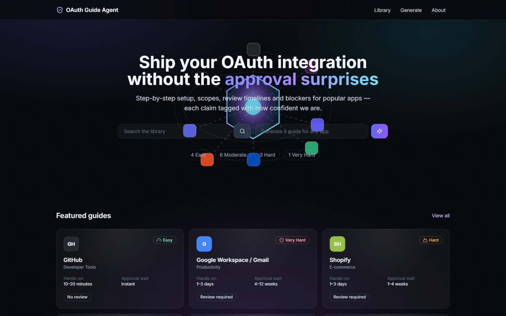
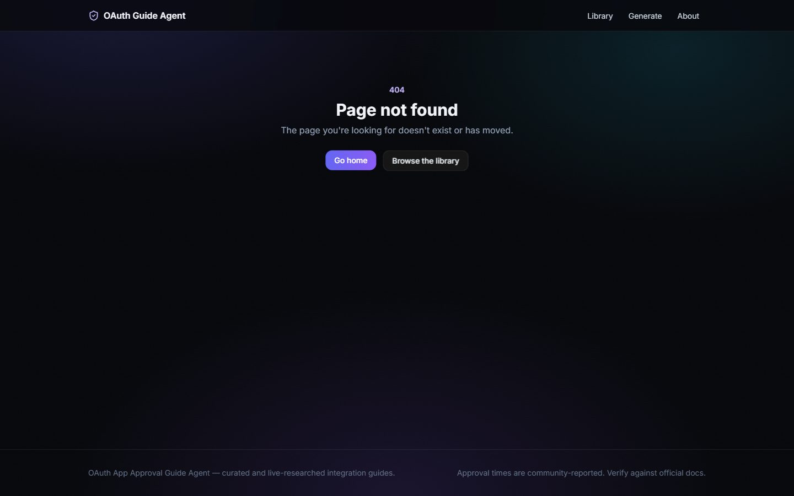
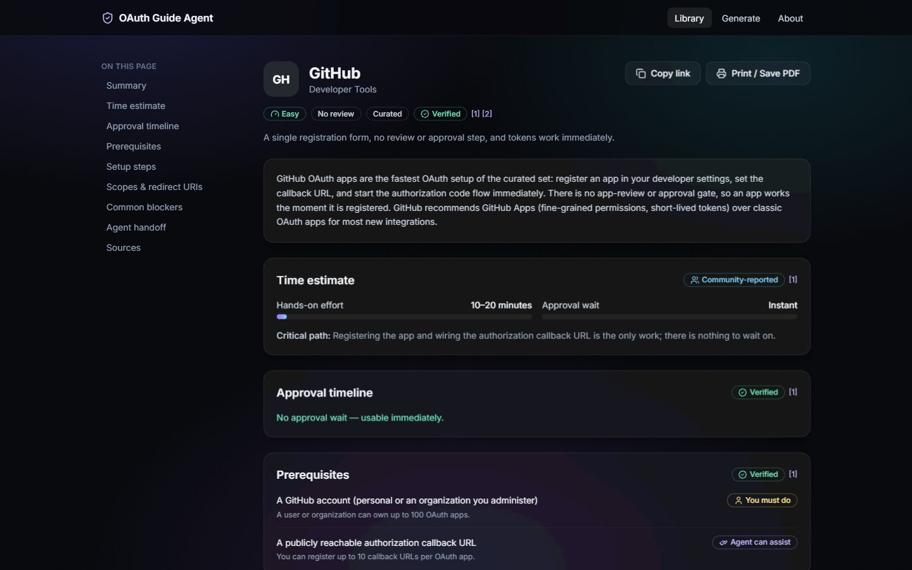
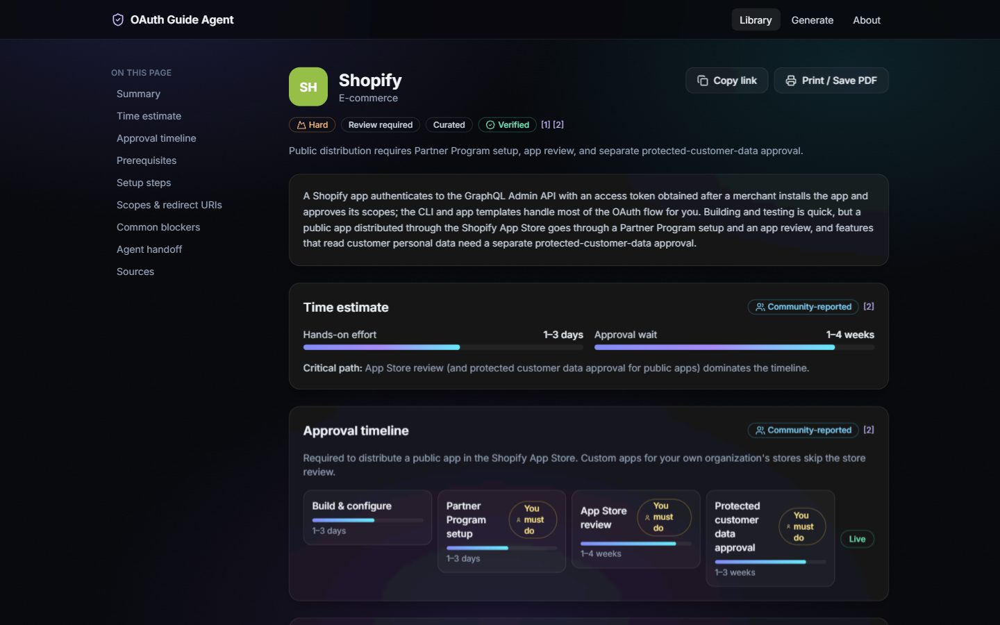
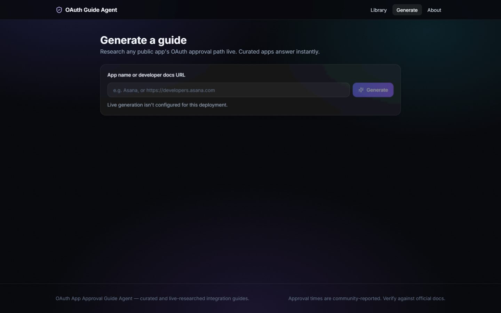
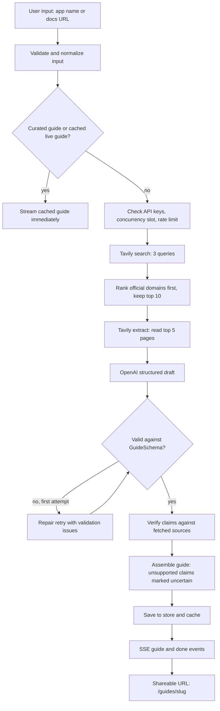
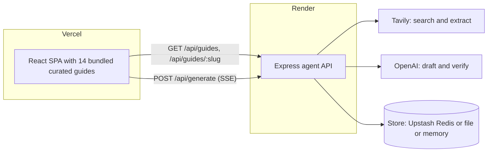

# OAuth Setup Guide Agent

Know before you build: how hard a provider's OAuth app is to set up and get approved, what you must do yourself, what an agent can do for you, and what will block you. Every claim links to an official source.


| Live app | API health | Repository |
|---|---|---|
| [oauth-setup-guide-agent.vercel.app](https://oauth-setup-guide-agent.vercel.app/) | [oauth-setup-guide-agent-2.onrender.com/api/health](https://oauth-setup-guide-agent-2.onrender.com/api/health) | [github.com/yadavchandan84/oauth-setup-guide-agent](https://github.com/yadavchandan84/oauth-setup-guide-agent) |

> The API runs on Render's free tier, which sleeps when idle. If the first live generation fails or is slow, open the API health link, wait 30-60 seconds for `"status":"ok"`, then try again.



| Guide library | Guide detail (GitHub) |
|---|---|
|  |  |
| **Approval timeline (Shopify)** | **Live agent** |
|  |  |

More screenshots: [Google Workspace guide](submission/screenshots/04-guide-google.jpg), [About page](submission/screenshots/06-about.jpg).

## Contents

- [The problem](#the-problem)
- [Guide library](#guide-library)
- [How it works](#how-it-works)
- [Evidence and verification](#evidence-and-verification)
- [Key product decisions](#key-product-decisions)
- [Project structure](#project-structure)
- [Run locally](#run-locally)
- [Deploy](#deploy)
- [API reference](#api-reference)
- [Security and cost guards](#security-and-cost-guards)
- [Regenerating the submission PDF](#regenerating-the-submission-pdf)
- [Limitations and future work](#limitations-and-future-work)

## The problem

Before an AI agent can act on a user's GitHub, Gmail or Shopify account, the developer has to register an OAuth app with that provider and often get it approved. From the outside it is hard to tell whether that takes ten minutes or two months. Requirements are spread across many doc pages, and the blockers (restricted scopes, security assessments, publisher verification, partner programs) usually surface late.

This project answers those questions up front. For each app a developer gets:

- A difficulty level with a one-line reason.
- Hands-on effort, reported separately from approval wait, plus the critical path.
- Prerequisites and step-by-step setup, each labeled **Agent can do**, **You must do** or **Agent can assist**.
- Recommended scopes, sensitive scopes and what requesting them triggers.
- Known blockers with symptom, cause and resolution.
- An agent vs human handoff list.
- A verification block: sources, what was checked, what was corrected, what is still uncertain, and the last verified date.

It ships as a curated library of 14 guides and a live agent that drafts a guide in the same format for any other app, with a shareable `/guides/<slug>` link.

## Guide library

All 14 curated guides live in [`shared/guides/`](shared/guides) and were last verified on 2026-10-20. Numbers below come straight from the JSON.

| App | Difficulty | Hands-on effort | Approval wait | Review required |
|---|---|---|---|---|
| GitHub | Easy | 10-20 min | None | No |
| Discord | Easy | 15-30 min | None | No (only for restricted scopes or large bots) |
| Linear | Easy | 15-30 min | None | No |
| Notion | Easy | 30-60 min | None | No (optional listing) |
| Atlassian Jira (OAuth 2.0 3LO) | Moderate | 1-2 hours | None | No (optional listing) |
| Figma | Moderate | 1-2 hours | Not published | Yes: app review for public apps |
| Salesforce Connected App | Moderate | 1-2 hours | 2-10 min (settings propagation) | No (optional listing) |
| HubSpot | Moderate | 1-3 hours | None | No (optional listing) |
| Slack | Moderate | 1-3 hours | None | No (optional Marketplace listing) |
| Stripe Connect | Moderate | 2-6 hours | 0-3 days | No (platform onboarding) |
| Microsoft Entra ID / Graph | Hard | 2-4 hours | 1-5 days | Yes: publisher verification, admin consent |
| Shopify | Hard | 1-3 days | 1-4 weeks | Yes: Partner Program, app review |
| Zoom | Hard | 1-2 days | 1-4 weeks | Yes: Marketplace app review |
| Google Workspace / Gmail | Very Hard | 1-3 days | 4-12 weeks | Yes: OAuth verification, CASA security assessment |

Figma's guide records `0-0` for approval wait because Figma does not publish a review turnaround; the guide marks that duration as uncertain.

## How it works

The frontend bundles the curated guides at build time, so the library and every curated guide page load without the backend. The backend is only needed for live generation and for permalinks to live-generated guides.

### Live agent pipeline

`POST /api/generate` streams every stage over Server-Sent Events. A typical fresh run takes 30-90 seconds.



If the draft is still invalid after one repair, the run fails with `LLM_FAILED`. If the verify pass fails, the guide is still saved and its `uncertain` list says it is unverified.

### Architecture



| Layer | Tech |
|---|---|
| Frontend | React 18, Vite 5, TypeScript, Tailwind CSS, Framer Motion, React Three Fiber (3D hero with a static fallback) |
| Backend | Node 22, Express 4, TypeScript, zod, helmet, express-rate-limit, OpenAI SDK, Upstash Redis |
| Shared | One zod `GuideSchema` in [`shared/schema.ts`](shared/schema.ts), used by both apps and the tests |

## Evidence and verification

Every section of a guide carries a confidence level from the `Confidence` enum in `shared/schema.ts`:

| Level | Meaning |
|---|---|
| `verified` | Supported by an official source cited in the guide |
| `community` | Widely reported but not stated in official docs |
| `uncertain` | Not clearly supported by the sources; treat as an estimate |

Each source is tagged `official` or `community`, and section confidence points at the exact sources by index.

**Curated guides.** Each guide was researched from the provider's official developer docs, then checked claim by claim. Doc moves and stale URLs were fixed and recorded under `verification.corrected`. Anything the docs do not state, such as review turnaround times, was recorded under `verification.uncertain`.

**Link check.** [`scripts/check-links.mjs`](scripts/check-links.mjs) fetches every URL cited by the curated guides and writes [`shared/link-check-report.json`](shared/link-check-report.json). Last run (2026-10-22): 50 URLs, 46 ok, 4 redirected, 0 blocked, 0 broken. The 4 redirects are locale or login redirects (for example `github.com/settings/developers` sends anonymous users to the login page).

**Live guides.** The agent drafts only from the pages it fetched, then a separate verify pass judges each section against those numbered sources. Claims it cannot support are marked `uncertain`, and console URLs that do not come from a retrieved domain are dropped.

**What the tests cover.** The keyed live path (real OpenAI and Tavily calls) is tested with stubbed providers: the pipeline, LLM, Tavily and store tests inject fakes, and no test calls the real APIs. A real end-to-end run happens after deploy, with the author's keys.

<details>
<summary>Notable findings from the curated guides</summary>

| Guide | Type | Finding |
|---|---|---|
| Figma | Learned | Public apps are reviewed by Figma on publish, so review is required. This was open in the plan and resolved from the docs. |
| Google Workspace | Corrected | Verification help moved to `support.google.com/cloud/answer/13463073` (older drafts cited `answer/9110914`). |
| Microsoft Entra ID | Corrected | Azure AD is now Microsoft Entra ID; citations point to current `learn.microsoft.com/entra` pages. |
| Slack | Corrected | Docs moved from `api.slack.com` to `docs.slack.dev`. |
| Stripe Connect | Corrected | Docs moved from `stripe.com/docs` to `docs.stripe.com`. |
| Discord | Corrected | Docs moved to `docs.discord.com/developers`. |
| HubSpot | Could not verify | Whether a new app should use the legacy public-app flow or the newer projects flow is not settled in the docs. |
| Google Workspace | Could not verify | Google does not publish verification or CASA wait times. |
| Shopify | Could not verify | App Store review durations are not published. |
| Zoom | Could not verify | Per-stage review durations are not published. |
| Discord | Could not verify | The 100-server bot verification threshold is widely reported; kept as community-reported. |

</details>

## Key product decisions

| Decision | Rationale |
|---|---|
| Focused scope: OAuth app setup and approval only | That is the step that blocks a developer from connecting users. Token handling and SDK usage are well documented elsewhere. |
| Split hands-on effort from approval wait | "One hour" and "six weeks" are both true for Google. Developers plan differently for work they do vs time they wait on. |
| Label every step agent / you / assist | The audience builds agents. Showing what can be automated and where a human must sign in, pay or sign is the useful part. |
| Evidence levels on every section | A guide that looks confident but is wrong costs more than one that says "uncertain". |
| Curated first, then cache, then a live run | Common apps answer instantly and never spend OpenAI or Tavily credits. Live results are cached for 168 hours by default. |
| SSE progress streaming | A 30-90 second run feels broken with a spinner. Streaming each search, read, draft and verify step shows the agent working. |
| Vercel frontend + Render backend (Option A) | A long-lived Express server has no serverless function timeout, so long agent runs stream to completion. |
| Pluggable store (Upstash, file, memory) | Render's free filesystem is lost on every redeploy, restart and spin-down (after about 15 idle minutes). With Upstash credentials, live guide links survive all of these. |

## Project structure

```text
.
├── backend/              Express agent API (deploys to Render)
│   ├── src/agent/        input normalization, Tavily, OpenAI, pipeline, post-processing
│   ├── src/middleware/   CORS, rate limit, concurrency, errors
│   ├── src/routes/       health, guides, generate
│   ├── src/store/        memory, file and Upstash stores
│   └── .env.example
├── frontend/             React + Vite SPA (deploys to Vercel)
│   ├── src/components/   guide sections, generate UI, 3D hero, UI kit
│   ├── src/pages/        Landing, Library, GuideDetail, Generate, About
│   ├── src/lib/          API client, SSE stream parser, helpers
│   ├── vercel.json
│   └── .env.example
├── shared/
│   ├── schema.ts         zod GuideSchema and SSE wire types
│   ├── guides/           14 curated guide JSON files
│   └── link-check-report.json
├── scripts/
│   ├── sync-shared.mjs   copies shared/ into */src/generated before dev, build, test
│   └── check-links.mjs   verifies every cited URL
├── submission/           PDF builder, screenshot capture, content, screenshots
├── render.yaml           Render Blueprint for the backend
└── package.json          root convenience scripts
```

`frontend/src/generated/` and `backend/src/generated/` are gitignored and rebuilt by `sync-shared.mjs`, which runs automatically as a `pre*` script.

## Run locally

**Prerequisites:** Node.js 22 (backend `engines` allows `>=20.3 <23`) and npm.

Install dependencies:

```bash
npm --prefix backend install
npm --prefix frontend install
```

Create env files (PowerShell users can use `Copy-Item` instead of `cp`):

```bash
cp backend/.env.example backend/.env
cp frontend/.env.example frontend/.env
```

The curated library works with no keys. To enable live generation, set `OPENAI_API_KEY` and `TAVILY_API_KEY` in `backend/.env`.

Run the backend on http://localhost:8787 (terminal 1):

```bash
npm --prefix backend run dev
```

Run the frontend on http://localhost:5173 (terminal 2):

```bash
npm --prefix frontend run dev
```

Tests, type checks and the link checker:

```bash
npm --prefix backend test
npm --prefix frontend test
npm --prefix backend run typecheck
npm --prefix frontend run build
npm run check:links
```

Last local run: backend 115 tests passing, frontend 38 tests passing, frontend production build clean. `check:links` needs network access and is not part of `npm test`.

> If `npm --prefix <dir> install` fails on your npm version, run `npm install` from inside that folder instead.

## Deploy

### 1. Backend on Render

The repo root has a [`render.yaml`](render.yaml) Blueprint. In Render choose **New > Blueprint**, select the repo, and it creates the service with these settings:

| Setting | Value |
|---|---|
| Service | `oauth-guide-agent-api`, web, runtime `node`, plan `free`, region `oregon` |
| Root directory | Repo root (leave blank). The build runs `../scripts/sync-shared.mjs` and reads `../shared`, so it must not be `backend`. |
| Build command | `cd backend && npm ci --include=dev && npm run build` |
| Start command | `cd backend && npm start` |
| Health check path | `/api/health` |
| Node version | `NODE_VERSION=22` |
| Auto deploy | On |

Render prompts for the `sync: false` values. Set `OPENAI_API_KEY`, `TAVILY_API_KEY`, and optionally both Upstash variables. Leave `ALLOWED_ORIGINS` blank for now; you set it after the frontend exists.

<details>
<summary>All backend environment variables</summary>

Names match [`backend/.env.example`](backend/.env.example), [`render.yaml`](render.yaml) and `backend/src/config.ts`. Values in the Default column are code defaults; secrets have none.

| Variable | Default | Description |
|---|---|---|
| `PORT` | `8787` | HTTP port. `render.yaml` sets `10000`. |
| `NODE_ENV` | `development` | `development`, `production` or `test`. |
| `ALLOWED_ORIGINS` | localhost:5173, localhost:4173 | Comma-separated CORS allowlist. Set to the Vercel URL in production. |
| `OPENAI_API_KEY` | none (secret) | Enables live drafting and verification. Missing means `503 CONFIG_MISSING`. |
| `OPENAI_MODEL` | `gpt-4o-mini` | Model used for draft and verify. |
| `TAVILY_API_KEY` | none (secret) | Enables doc search and extraction. Missing means `503 CONFIG_MISSING`. |
| `UPSTASH_REDIS_REST_URL` | none | Upstash Redis REST URL for durable links. Set both Upstash vars or neither. |
| `UPSTASH_REDIS_REST_TOKEN` | none (secret) | Upstash Redis REST token. |
| `STORE` | `auto` | `auto`, `memory`, `file` or `upstash`. `auto` uses Upstash when credentials exist, else file. |
| `DATA_DIR` | `./.data` | File store directory, relative to `backend/`. Ephemeral on Render free: lost on redeploy, restart and spin-down. |
| `RATE_LIMIT_MAX` | `5` | Live generations allowed per IP per window. `render.yaml` sets `15` so reviewers behind a shared proxy IP don't hit `429` mid-demo. |
| `RATE_LIMIT_WINDOW_MS` | `3600000` | Rate limit window (1 hour). |
| `MAX_CONCURRENT_GENERATIONS` | `2` | Simultaneous live runs before `503 BUSY`. |
| `GENERATION_TIMEOUT_MS` | `120000` | Hard timeout per live run (allowed 30000-300000). `render.yaml` sets `180000` for headroom on slow LLM calls. |
| `CACHE_TTL_HOURS` | `168` | How long a live guide is reused for the same app. |
| `TRUST_PROXY` | `1` | Proxy hops to trust for client IPs. Render uses one proxy. |
| `LOG_LEVEL` | `info` | `debug`, `info`, `warn` or `error`. |

Invalid values, or only one of the two Upstash variables, stop the server at boot with a logged error.

</details>

### 2. Frontend on Vercel

Import the repo in Vercel and use:

| Setting | Value |
|---|---|
| Root Directory | `frontend` |
| Framework preset | Vite |
| Build command | `npm run build` |
| Output directory | `dist` |
| Include source files outside of the Root Directory | Enabled. `prebuild` reads `../shared` and `../scripts`. |
| Environment variable | `VITE_API_URL` = your Render URL, for example `https://<your-service>.onrender.com` |

[`frontend/vercel.json`](frontend/vercel.json) rewrites all paths to `index.html` so deep links like `/guides/github` work, caches `/assets/*` as immutable, and sets `X-Content-Type-Options` and `Referrer-Policy` headers.

### 3. Connect them

1. In Render, set `ALLOWED_ORIGINS` to the Vercel URL, for example `https://<your-app>.vercel.app` (no trailing slash needed). Add more origins comma-separated.
2. Redeploy the Render service and open `<RENDER_URL>/api/health`. Check that `llmConfigured` and `searchConfigured` are `true` and `store` is `upstash` if you set it.
3. Open the Vercel URL and run one live generation.

### 4. Keep Render warm

Render's free tier sleeps after inactivity and the first request can take 30-60 seconds. Add a free UptimeRobot HTTP monitor on `<RENDER_URL>/api/health` every 10 minutes, and open the health URL yourself before a demo. A paid Render instance removes cold starts.

## API reference

| Method | Path | Description |
|---|---|---|
| `GET` | `/api/health` | `status`, `uptimeSec`, `version`, `store`, `llmConfigured`, `searchConfigured`, `rateLimitMax`, `time` |
| `GET` | `/api/guides` | `{ curated, recent }`: summaries of curated guides and up to 20 recent live guides |
| `GET` | `/api/guides/:slug` | Full guide JSON. `400 INVALID_SLUG`, `404 NOT_FOUND` or `503 STORE_UNAVAILABLE` on failure. |
| `POST` | `/api/generate` | Body `{"app": "<name or URL>", "force": false}`. Responds with an SSE stream. |

```bash
curl -N -X POST http://localhost:8787/api/generate \
  -H "Content-Type: application/json" \
  -d '{"app":"Asana"}'
```

`-N` turns off curl buffering so events print as they arrive. Set `"force": true` to skip the curated and cache lookup.

<details>
<summary>SSE events and error codes</summary>

Event names come from `StreamEvent` in `shared/schema.ts`:

| Event | Payload |
|---|---|
| `meta` | `requestId`, `query`, `appName`, `key`, `startedAt`, `force` |
| `step` | `id`, `stage` (`resolve`, `search`, `read`, `draft`, `verify`, `save`), `status` (`active`, `done`, `failed`, `skipped`), `label`, optional `detail`, `at` |
| `source` | `index`, `url`, `title`, `kind` (`official` or `community`) |
| `guide` | `guide`, `origin` (`curated`, `cache` or `fresh`), `cached`, `persisted` |
| `error` | `code`, `message`, `retryable` |
| `done` | `ok`, `slug`, `durationMs` |

Sample stream (abbreviated):

```text
event: meta
data: {"requestId":"...","query":"Asana","appName":"Asana","key":"asana",...}

event: step
data: {"id":"search","stage":"search","status":"done","label":"Searching docs…","detail":"Found 10 relevant pages",...}

event: guide
data: {"guide":{...},"origin":"fresh","cached":false,"persisted":true}

event: done
data: {"ok":true,"slug":"...","durationMs":...}
```

Errors before the stream starts are JSON: `{ "error": { "code", "message", "retryAfterSec"? } }`. Codes: `INVALID_INPUT`, `INVALID_SLUG`, `NOT_FOUND`, `RATE_LIMITED`, `BUSY`, `CONFIG_MISSING`, `SEARCH_FAILED`, `NO_SOURCES`, `LLM_FAILED`, `TIMEOUT`, `STORE_UNAVAILABLE`, `INTERNAL`.

Without API keys, `/api/generate` still returns curated and cached guides; a fresh run returns `503 CONFIG_MISSING` with a message that the curated library still works.

</details>

## Security and cost guards

- **No secrets in the repo.** `.env*` is gitignored except `.env.example`, which has empty secret values. Keys live in Render environment variables.
- **CORS allowlist.** Only origins in `ALLOWED_ORIGINS` (default: localhost) can call the API from a browser.
- **Rate limit.** 5 live generations per IP per hour by code default; the Render blueprint raises this to 15 for the review window. Over the limit returns `429 RATE_LIMITED` with `Retry-After`. Curated and cached answers do not count.
- **Concurrency cap.** At most 2 live runs at once (`503 BUSY` beyond that).
- **Input validation.** `/api/generate` accepts a strict JSON body up to 2 KB. App names are limited to 80 characters, URLs to 200, and localhost or IP addresses are rejected. Slugs are validated by regex.
- **Timeout.** Each live run is aborted after 120 seconds by code default (180 seconds on Render via `render.yaml`), and client disconnects cancel the run.
- **Cache.** Live guides are reused for 168 hours per app, so repeat requests cost nothing.
- **Untrusted web content.** Prompts tell the model to treat fetched pages as data, not instructions. Console URLs outside retrieved domains are removed.
- **Headers.** `helmet` on the API; `nosniff` and `Referrer-Policy` on the SPA.

## Regenerating the submission PDF

The PDF is `submission/Composio_OAuth_Guide_Agent_Submission.pdf`.

1. Fill in [`submission/links.config.json`](submission/links.config.json): `VERCEL_URL`, `RENDER_URL`, `REPO_URL` (and optionally `SUBMISSION_DATE`). The build warns on any value still containing `YOUR-`.
2. Install, build and preview the frontend (preview serves http://localhost:4173):

```bash
npm --prefix submission install
npm --prefix frontend run build
npm --prefix frontend run preview
```

3. In a second terminal, capture screenshots and build the PDF:

```bash
npm --prefix submission run screenshots
npm --prefix submission run pdf
```

`npm --prefix submission run pdf:draft` runs the same build with `--draft`. Draft mode still writes the PDF but does not fail when the link-check report has broken URLs or fewer than 4 screenshots exist; use it while URLs are still placeholders. To capture screenshots from the deployed site instead, set `BASE_URL` to the Vercel URL before `run screenshots`.

## Limitations and future work

**Limitations**

- Live guide quality depends on what Tavily finds. Thin or outdated docs produce thinner guides, and those sections are marked uncertain.
- Approval waits are estimates. Most providers do not publish review turnaround times.
- Provider docs change often. Curated guides need periodic re-verification (last verified 2026-10-20).
- Render free tier cold starts can add 30-60 seconds to the first request.
- Without Upstash, live guides are stored on Render's ephemeral filesystem, which is lost on redeploy, on restart, and when the free service spins down after about 15 idle minutes. Live-guide links can therefore break after inactivity. An UptimeRobot ping reduces spin-downs but does not remove restarts or redeploys; configure Upstash for durable links.
- The keyed live path (real OpenAI and Tavily calls) is covered by tests with stubbed providers only. A real end-to-end run happens after deploy, with the author's keys.
- The rate limit is in-memory and per instance, which is fine for one free instance but not for horizontal scaling.

**Future work**

- Grow the library toward 100 guides, prioritized by which integrations agent builders ask for.
- Scheduled re-verification: re-run the link check and the verify pass weekly and flag drift.
- Provider change detection: watch cited doc pages and alert when a guide's sources change.
- Browser agents that attempt the console steps labeled "Agent can do" and hand off at the "You must do" points.

---

Author: [yadavchandan6103@gmail.com](mailto:yadavchandan6103@gmail.com). Built for the Composio APM Integrations take-home (Product Intern).
